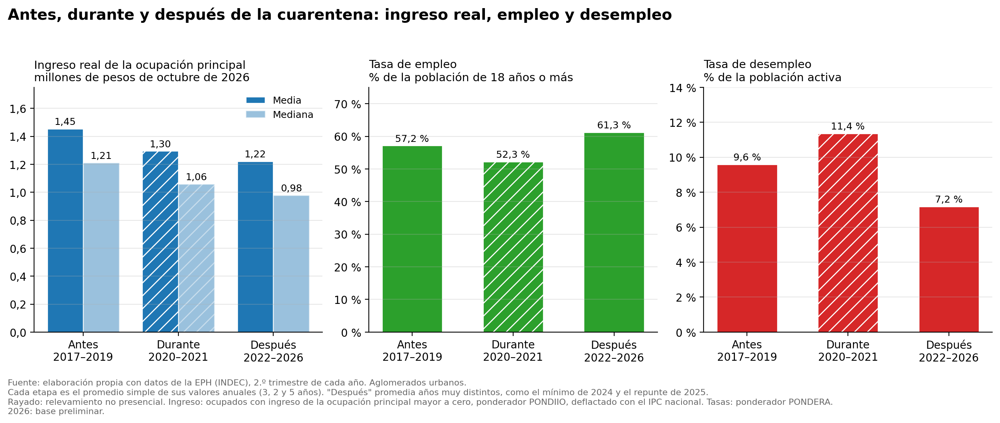
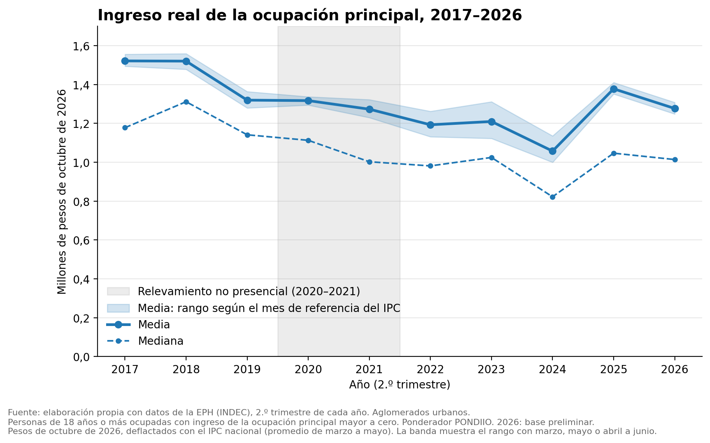
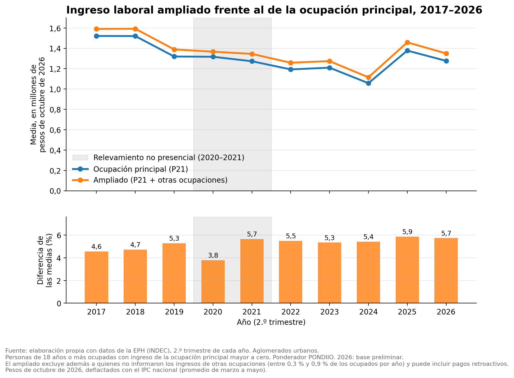
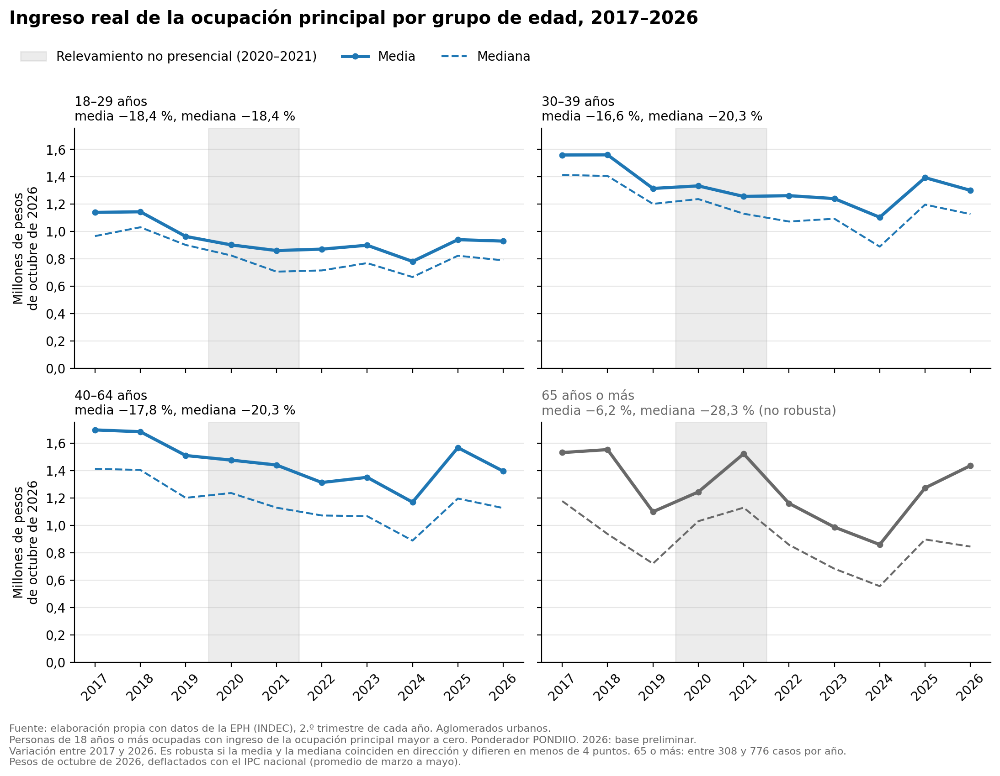
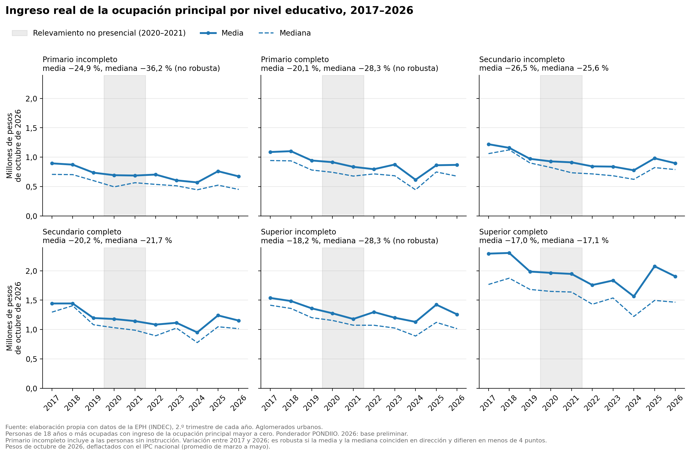
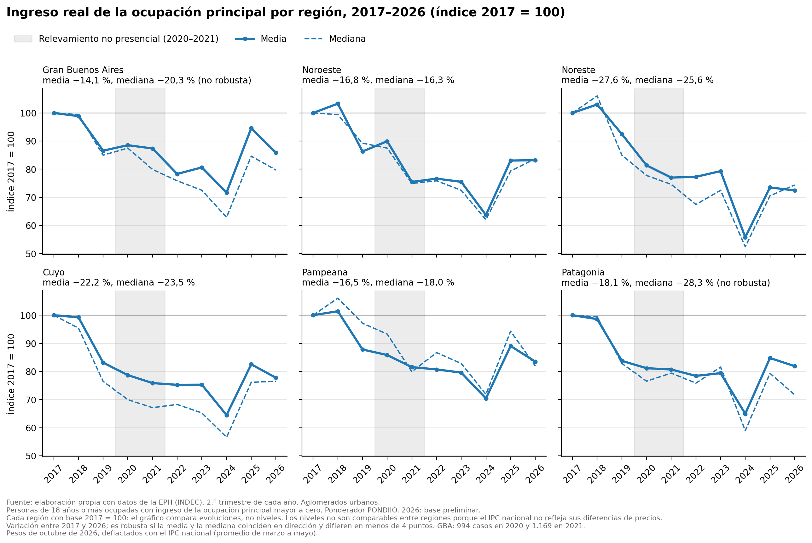
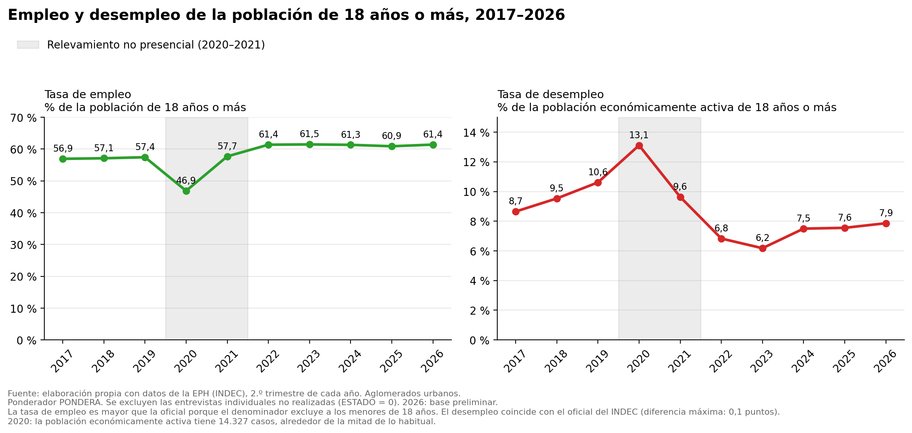

# Ingresos laborales en Argentina, 2017–2026

**Cómo evolucionaron los ingresos laborales según la edad, el nivel educativo y la región, antes, durante y después de la cuarentena.**

Análisis de los microdatos de la **Encuesta Permanente de Hogares (EPH)** del INDEC, para el segundo trimestre de cada año entre 2017 y 2026, con los ingresos ajustados por inflación a **pesos de octubre de 2026**.



---

## Hallazgos principales

- **El ingreso real de la ocupación principal es menor en 2026 que en 2017.** La media bajó un 16,1 % (de 1,52 a 1,28 millones de pesos de octubre de 2026) y la mediana, un 13,9 %.
- **La caída no empezó en 2020.** Entre 2018 y 2019 la media y la mediana ya habían bajado alrededor de un 13 %. El punto más bajo de la serie es 2024, alrededor de un 30 % por debajo de 2017. En 2025 hubo un repunte y en 2026 (dato preliminar) el ingreso vuelve a bajar.
- **La caída alcanzó a todos los grupos, pero el orden entre ellos se mantuvo:**
  - las personas de 18 a 29 años siguen teniendo el ingreso más bajo;
  - a mayor nivel educativo, mayor ingreso;
  - Patagonia sigue siendo la región con el ingreso más alto.
- **El Noreste es la región que más cayó (−27,6 %).** El nivel superior completo es el nivel educativo que menos cayó (−17,0 %).
- **El mercado de trabajo y el ingreso se movieron en direcciones distintas.** Después de la cuarentena (2022–2026), en comparación con antes (2017–2019), hay más empleo (61,3 % frente a 57,2 %) y menos desempleo (7,2 % frente a 9,6 %), pero el ingreso real medio de quienes trabajan es alrededor de un 16 % menor.

Estos resultados **describen** lo que se observó: no permiten afirmar que la cuarentena ni ningún otro factor haya causado los cambios. En 2020 y 2021 la encuesta se hizo por teléfono y sus cifras no son del todo comparables, así que las conclusiones comparan los años relevados en persona.

📄 **Lectura completa:** [`documentacion/hallazgos_y_limitaciones.md`](documentacion/hallazgos_y_limitaciones.md). Incluye un hallazgo por pregunta, a quién representan los resultados, cómo leer 2020 y 2021, las limitaciones y un glosario.

---

## Preguntas del proyecto

**Pregunta principal:** ¿cómo evolucionaron los ingresos laborales según la edad, el nivel educativo y la región entre 2017 y 2026?

1. ¿Cómo cambió el ingreso de la ocupación principal año por año?
2. ¿Qué diferencias se observan entre los grupos de edad?
3. ¿Cómo varían los ingresos según el nivel educativo?
4. ¿Qué diferencias aparecen entre las regiones?
5. ¿Qué cambia al considerar también los ingresos de otras ocupaciones?
6. ¿Cómo evolucionaron el empleo y el desempleo?
7. ¿Qué se observa al resumir antes, durante y después de la cuarentena?

## Datos y método

| Aspecto | Decisión |
|---|---|
| **Fuente** | EPH del INDEC: bases individuales del 2.º trimestre de 2017 a 2026 (2026 es una base preliminar) |
| **Población** | Personas de 18 años o más de los 31 aglomerados urbanos de la EPH |
| **Indicador central** | Ingreso de la ocupación principal (`P21`) de quienes declaran un ingreso mayor a cero, con el ponderador `PONDIIO` |
| **Complemento** | Ingreso laboral ampliado (`P21` + `TOT_P12`, otras ocupaciones) |
| **Contexto** | Tasas de empleo y de desempleo (`ESTADO`), con el ponderador `PONDERA` |
| **Inflación** | IPC nacional del INDEC (base diciembre de 2016 = 100); deflactor: promedio de marzo a mayo de cada año; pesos de octubre de 2026 |
| **Grupos** | Edad (18–29, 30–39, 40–64, 65 o más), nivel educativo (`NIVEL_ED`, 6 categorías) y región (6) |
| **Estadísticos** | Media, mediana y percentiles ponderados. Una variación es *sólida* si la media y la mediana coinciden en dirección y difieren en menos de 4 puntos. |
| **Etapas** | Antes (2017–2019), durante (2020–2021, relevamiento telefónico) y después (2022–2026) |

## Figuras

| | |
|---|---|
|  |  |
| **1.** Evolución anual del ingreso real | **2.** Ingreso ampliado frente al central |
|  |  |
| **3.** Por grupo de edad | **4.** Por nivel educativo |
|  |  |
| **5.** Por región (índice 2017 = 100) | **6.** Empleo y desempleo |

Cada figura está en `resultados/` en dos formatos: SVG (vectorial) y PNG.

## Estructura del repositorio

```text
├── README.md
├── notebooks/
│   ├── 01_preparacion.ipynb       # descarga, limpieza, población y ajuste por inflación
│   ├── 02_analisis.ipynb          # estadísticos ponderados, cruces, tasas y resúmenes → 13 tablas
│   ├── 03_visualizaciones.ipynb   # 7 figuras (SVG y PNG)
│   └── 04_interpretacion.ipynb    # hallazgos junto a las figuras, con control de las cifras citadas
├── documentacion/
│   ├── hallazgos_y_limitaciones.md        # lectura principal
│   ├── inventario_fuentes.md              # bases del INDEC usadas
│   ├── ficha_variables_eph.md             # variables, categorías y códigos especiales
│   ├── comparabilidad_variables.md        # comparabilidad entre años
│   ├── notas_metodologicas_2020.md        # relevamiento telefónico
│   ├── registro_etapa*.md                 # decisiones de cada etapa
│   └── registro_descarga_*.csv, verificacion_bases_eph.csv
└── resultados/
    ├── *.csv                              # 13 tablas de resultados
    └── fig01 … fig07 (.svg y .png)
```

## Cómo reproducirlo

Las bases de la EPH no están en el repositorio porque son pesadas y las publica el INDEC. El notebook 01 las descarga.

1. En Google Drive ("Mi unidad"), crea la carpeta `eph_ingresos` con estas subcarpetas:
   `datos_originales/eph`, `datos_originales/ipc`, `datos_procesados`, `documentacion`, `notebooks` y `resultados`.
2. Copia los notebooks a `eph_ingresos/notebooks/` y ábrelos con Google Colab.
3. Ejecuta los notebooks en orden, cada uno con *Entorno de ejecución → Reiniciar y ejecutar todo*:
   1. **`01_preparacion`**: descarga las bases del 2.º trimestre ([sitio de la EPH](https://www.indec.gob.ar/ftp/cuadros/menusuperior/eph/)) y la [serie del IPC](https://www.indec.gob.ar/ftp/cuadros/economia/serie_ipc_divisiones.csv), y genera las bases procesadas. Necesita conexión a internet la primera vez.
   2. **`02_analisis`**: genera las 13 tablas de `resultados/`.
   3. **`03_visualizaciones`**: genera las 7 figuras.
   4. **`04_interpretacion`**: muestra los hallazgos y comprueba que las cifras del texto coincidan con las tablas.
4. Cada notebook monta Drive y define las rutas al comienzo. Si usas otra carpeta, cambia la constante `RAIZ`.

**Versiones de referencia:** Python 3.13.18, pandas 2.2.3, matplotlib 3.10.0 y numpy 2.4.6 (Colab, noviembre de 2026). Cada notebook muestra las versiones en uso al ejecutarse.

**Aviso:** el INDEC puede reemplazar la base preliminar de 2026 por una definitiva. Si eso ocurre, las cifras pueden cambiar, y la sección 17 del notebook 04 indica qué cifras del texto hay que actualizar.

## Limitaciones principales

- Los resultados representan a los **aglomerados urbanos** relevados por la EPH, no a la población rural ni al total del país.
- **2020 y 2021** se relevaron por teléfono: menor respuesta, menor calidad en GBA y posible subdeclaración de ingresos.
- Entre el **18 % y el 25 %** de los ocupados no declara su ingreso, según el año. El ponderador `PONDIIO` lo compensa bajo el supuesto de que quienes no responden se parecen a quienes sí lo hacen.
- Los ingresos se declaran en **valores redondos**, por eso se usan juntas la media y la mediana.
- **Sin pruebas de significación:** las bases públicas no permiten calcular errores estándar exactos. Las diferencias son descriptivas.
- Se usa el **IPC nacional** para todas las regiones: las tendencias regionales son comparables, pero los niveles de ingreso entre regiones no lo son en poder de compra.

El detalle de las 13 limitaciones está en [`hallazgos_y_limitaciones.md`](documentacion/hallazgos_y_limitaciones.md#5-limitaciones).

## Fuentes

- INDEC, [Encuesta Permanente de Hogares: bases de microdatos](https://www.indec.gob.ar/ftp/cuadros/menusuperior/eph/).
- INDEC, [Índice de Precios al Consumidor, serie por divisiones](https://www.indec.gob.ar/ftp/cuadros/economia/serie_ipc_divisiones.csv).
- INDEC, [Consideraciones metodológicas de la EPH, 2.º trimestre de 2020](https://www.indec.gob.ar/ftp/cuadros/menusuperior/eph/EPH_consideraciones_metodologicas_2t20.pdf).

Los resultados son de elaboración propia a partir de los microdatos del INDEC. No son estadísticas oficiales.

## Autor

**Jean Pierre Esquen** · [GitHub](https://github.com/Jean5011)
